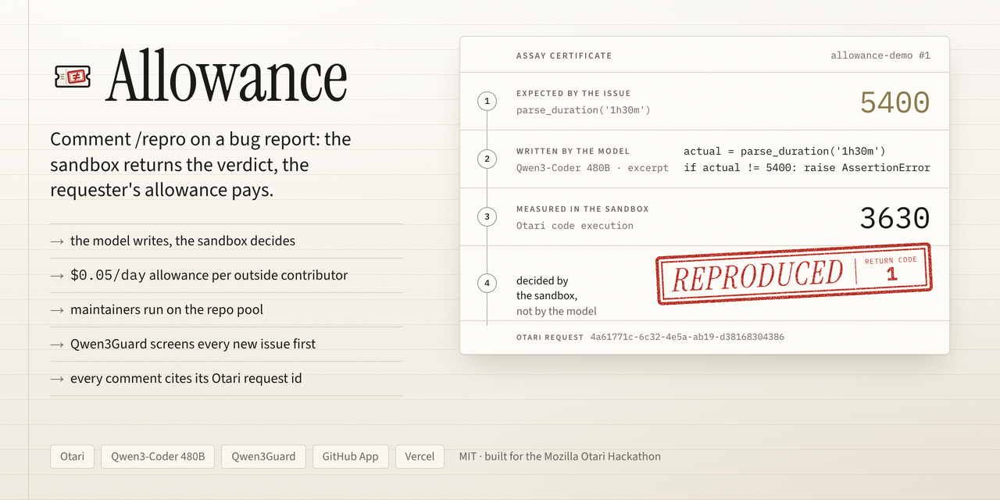

<div align="center">
  
  <h1>Allowance 🧾</h1>
  <p><em>Every outside contributor gets their own capped AI allowance. <code>/repro</code> reproduces a bug report in a sandbox, and the sandbox run, not the model, decides if it is real.</em></p>
  

  <br/>

  [](https://allowance.edycu.dev)
  [](https://github.com/edycutjong/allowance-demo/issues)
  [](https://dorahacks.io/hackathon/mozilla-devs-wilding/detail)

  <br/>

  
  
  
  [](LICENSE)
  [](https://github.com/edycutjong/allowance/actions/workflows/ci.yml)

</div>

---

## 💡 The Problem & Solution

### The Problem

A maintainer cannot hand an AI key to strangers, and cannot afford to triage every vague "it crashes" report by hand. A model that reads a bug report and says "confirmed" is also not evidence: it agrees with whatever the report claims.

### The Solution

Allowance is a GitHub App for open-source repositories, built on [Otari](https://otari.ai).

1. **Triage.** When an issue opens, a small open-weight model labels it and posts a welcome comment.
2. **Allowance.** Each outside contributor is an Otari end user with a budget of $0.05 a day. The comment footer shows how much of it is left. Maintainers are charged to the repository pool instead.
3. **`/repro`.** A code model, routed by an Otari policy, reads the issue and the repository through MCP and **writes** a short Python script. Allowance **runs** that script in Otari's sandbox. The verdict is the sandbox result: **Reproduced**, **Not reproduced** or **Inconclusive**. The model never grades itself.
4. **Guardrail.** The issue text is screened before the triage or coder model sees it. A flagged issue gets a `403 guardrail_violation`, no triage or coder call, and nothing charged to the contributor (the guard check itself runs on the repository key).

## 📸 See it in Action

Live proofs on the public demo repo [`edycutjong/allowance-demo`](https://github.com/edycutjong/allowance-demo). Walkthrough with every link: [DEMO.md](DEMO.md).

| Verdict | Issue | What happened |
|---|---|---|
| 🔴 Reproduced | [#1](https://github.com/edycutjong/allowance-demo/issues/1#issuecomment-6706198622) | `parse_duration('1h30m')`: expected 5400, got 3630. Sandbox return code 1. |
| 🟢 Not reproduced | [#4](https://github.com/edycutjong/allowance-demo/issues/4#issuecomment-6706220636) | A report with no real bug. The script passed, return code 0. |
| 🛡️ Blocked | [#5](https://github.com/edycutjong/allowance-demo/issues/5#issuecomment-6706212278) | Prompt injection in the issue text. Blocked by the guardrail, nothing charged. |

## 🏗️ Architecture & Tech Stack


| Layer | Choice |
|---|---|
| Runtime | TypeScript on Vercel Functions (Web `Request`/`Response`, no framework), Node 22+ |
| Gateway | Otari, `https://api.otari.ai/api/v1` |
| GitHub | GitHub App `allowance-bot`, JWT to installation token, REST over `fetch` |
| State | none: labels, comments and the Otari end-user record |
| Tests | `node:test` with `--experimental-strip-types` |

### Models and roles

| Role | Model | Provider |
|---|---|---|
| Write the repro script | Qwen3-Coder 480B Turbo, via routing policy `allowance-coder` | DeepInfra |
| Screenshot fallback (policy step 2) | Qwen3-VL | DeepInfra (configured in the policy; not yet observed in an app run) |
| Triage | Llama 3.3 70B Instruct | Bedrock |
| Guardrail | Qwen3Guard-Gen-8B | called from our `/validate` endpoint through Otari |

All four are open-weight. The fallback model is configured, but it has not served a run inside the app yet (see Limits).

## 🏆 Otari Integration

Each row links public runs (the first row two: coder on #1, triage on #4). "Request" is Otari's `otari-request-id`, also printed in the comment footer.

| Otari capability | How Allowance uses it | Proof |
|---|---|---|
| Open-weight models, distinct roles | Coder, triage and guard are three different models | [#1](https://github.com/edycutjong/allowance-demo/issues/1#issuecomment-6706198622) coder `4a61771c-6c32-4e5a-ab19-d38168304386`; [#4](https://github.com/edycutjong/allowance-demo/issues/4#issuecomment-6706212151) triage `e6f27738-99be-4629-aeab-125d371eb737` |
| Model routing | Every write goes to the policy `allowance-coder`, never to a fixed model | [#6](https://github.com/edycutjong/allowance-demo/issues/6#issuecomment-6708001599) request `c3709369-eae7-4d55-8c88-dba391c10472`, served by policy step 1, no fallback marker in the footer |
| MCP integration | The model reads repo files through the GitHub MCP server | [#4](https://github.com/edycutjong/allowance-demo/issues/4#issuecomment-6706220636) footer `tools: mcp ×5`, request `35de16cb-5126-4417-a174-5db39f6a365b` |
| Code execution | Allowance runs the written script with `POST /code/execute` | [#1](https://github.com/edycutjong/allowance-demo/issues/1#issuecomment-6706198622) sandbox return code 1 |
| Guardrails | Issue text is screened by our own `/validate` service backed by Qwen3Guard | [#5](https://github.com/edycutjong/allowance-demo/issues/5#issuecomment-6706212278) `403 guardrail_violation`, request `435df9c0-93c0-461c-849b-1cf269873d34` |
| Per-user budgets | Contributors are end users on `contributor-allowance`, $0.05 a day; the footer reads the balance back | [#4](https://github.com/edycutjong/allowance-demo/issues/4#issuecomment-6706212151) footer `$0.0000 of $0.05 left today · resets 2026-11-08 00:00 UTC` (read from Otari; this issue was opened by the owner before maintainers were moved to the pool) |

The footer's "repository pool" line (see [issue #7](https://github.com/edycutjong/allowance-demo/issues/7), request `db089b2e-a84e-4bc3-8ece-6d74dfe0a5d1`) is the contributors' combined spend today, read from Otari's end-user records, next to a $5/month ceiling that the app displays from its own setting. It is not a read of Otari's monthly key budget (the footers posted so far label it "Otari key budget", which overstates it: the number is the configured setting), and no run was ever refused by that ceiling, so no table row claims it. Every request id above is printed in the footer of the linked comment; the ones from #6 and #7 are also in [evidence/live-runs.md](evidence/live-runs.md).

### How a verdict is made

A model-written script runs only if it passes `lib/script-check.ts`: it installs this repository at a pinned commit, calls a project function the issue names, and raises the marker under a condition on that call's result. The verdict then reads only the exception that ends the sandbox's stderr. "Reproduced" means *the model's test failed when Allowance ran it*. The gate is a structural check, not proof that the model's expectation is right. Live examples: [#6](https://github.com/edycutjong/allowance-demo/issues/6#issuecomment-6708001599) reproduced at `9259e59`; [#7](https://github.com/edycutjong/allowance-demo/issues/7#issuecomment-6707750286), where a repair that changed the assertion was refused and the comment said so. Details: [evidence/live-runs.md](evidence/live-runs.md).

## ⚠️ Limits

- Otari guardrails screen the request text. MCP and web-fetch results and image content inside Otari's tool loop are **not** screened; we cannot screen them from outside. Allowance quotes at most 300 characters of the final sandbox error back to the model.
- Per-user budgets: the daily contributor refusal (`403 budget_exceeded`, scope `user`) was observed once in development, from a direct API call with a test user and a large `max_tokens`. It is not shown in the app yet: no outside contributor has hit it.
- The routing fallback to Qwen3-VL did not fire on the screenshot in issue #6: the first target accepted the image ([live-runs.md](evidence/live-runs.md)). The web-fetch tool is offered to the model. It was called once in each of two early, non-verdict runs ([#1](https://github.com/edycutjong/allowance-demo/issues/1#issuecomment-6706134836), [#6](https://github.com/edycutjong/allowance-demo/issues/6#issuecomment-6707469074)) and in none of the verdict runs above, so it is not claimed.
- A redelivered trigger whose run crashed is not rerun, to avoid a second charge. The failure comment that replaces the placeholder says to comment `/repro` again.
- A write turn with a screenshot and five MCP reads can take about two minutes.
- The demo bugs are in a repository we planted. Issues #1 to #7 are the development transcript, including early failed runs we kept. #1 and #4, and the first two `/repro` runs on #6, ran before the script gate and the pinned install; the #6 verdicts linked above (`9259e59`) and #7 ran under them.

## 🚀 Getting Started

### Prerequisites

Node 22+, an Otari workspace with a service key, a GitHub App (issues: write, contents: read; events: issues, issue comment), and a Vercel project.

### Installation

```bash
git clone -b otari https://github.com/edycutjong/allowance && cd allowance
npm ci && npm test
vercel deploy --prod --yes
```

Point the GitHub App webhook at `https://<your-host>/api/github`. Otari calls the guard at `https://<your-host>/api/guard/<GUARD_TOKEN>`; give it that base URL without `/validate`, because Otari appends it.

Environment variables (names only):

| Name | Purpose |
|---|---|
| `OTARI_API_KEY` | bot key: triage, maintainer runs |
| `OTARI_SERVICE_KEY` | service key: per-contributor end users, sandbox |
| `OTARI_BASE_URL` | optional gateway URL override |
| `OTARI_MCP_GITHUB_ID` | Otari MCP server id for GitHub |
| `GUARD_TOKEN` | secret path segment of the guard endpoint |
| `POOL_CEILING_USD`, `PUBLIC_BASE_URL` | optional: displayed pool ceiling (default 5), public base URL |
| `GITHUB_APP_ID`, `GITHUB_PRIVATE_KEY`, `GITHUB_WEBHOOK_SECRET` | GitHub App credentials |

Dry run without writing to GitHub: `node --experimental-strip-types scripts/repro.ts <issue-url> --as <login>`.

## 🧪 Testing & CI

```bash
npm test          # 94 tests, node:test
npm run typecheck # tsc --noEmit
```

CI runs the tests and a typecheck on every push, deploys the `otari` branch to Vercel, and smoke-tests `/api/health`.

## 📁 Project Structure

```
api/        github.ts (webhook), guard/ (the /validate service), health.ts
lib/        webhook, triage, repro, script-check, guard, otari, github, github-issue, comment, idempotency
scripts/    repro.ts (dry-run CLI)
test/       6 files: webhook, repro, script-check, guard, github, idempotency
evidence/   live-runs.md: measured runs with request ids
docs/       architecture.svg, OTARI-FEEDBACK.md
```

## 📽️ Demo Materials

[DEMO.md](DEMO.md) (the beats, with links) · [docs/OTARI-FEEDBACK.md](docs/OTARI-FEEDBACK.md) (what we hit building on Otari) · [live-runs.md](evidence/live-runs.md)

## 📄 License

[MIT](LICENSE)
