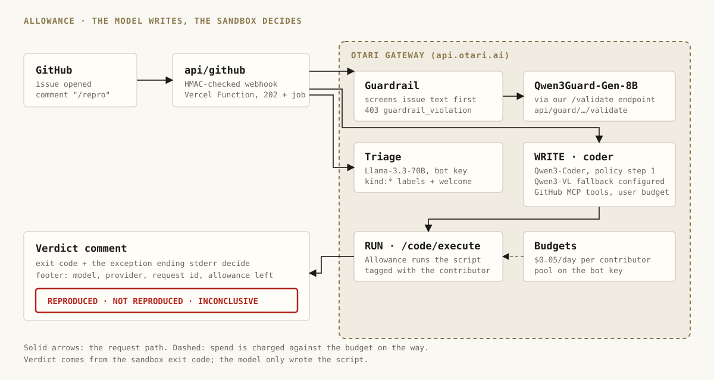

<div align="center">
  
  <h1>Allowance 🧾</h1>
  <p><em>Maintainers can't hand an AI key to strangers, and a model saying "confirmed" is not evidence. Allowance gives every outside contributor a capped Otari allowance; on <code>/repro</code> an open-weight model writes a test, Otari's sandbox runs it, and the verdict is what the run did, not what the model believes.</em></p>
  

  <br/>

  [](https://allowance.edycu.dev)
  [](https://allowance.edycu.dev/judge)
  [](https://github.com/edycutjong/allowance-demo/issues)
  [](https://allowance.edycu.dev/deck)
  [](https://dorahacks.io/hackathon/mozilla-devs-wilding/detail)

  <br/>

  
  
  
  [](LICENSE)
  [](https://github.com/edycutjong/allowance/actions/workflows/ci.yml)

</div>

---

## 💡 The Problem & Solution

### The Problem

A maintainer cannot hand an AI key to strangers, and cannot afford to triage every vague "it crashes" report by hand. A model that reads a bug report and says "confirmed" is also not evidence: it agrees with whatever the report claims.

### The Solution

Allowance is a GitHub App for open-source repositories, built on [Otari](https://otari.ai).

1. **Triage.** When an issue opens, a small open-weight model labels it and posts a welcome comment.
2. **Allowance.** Each outside contributor is an Otari end user with a budget of $0.05 a day. The comment footer shows how much of it is left. Maintainers are charged to the repository pool instead.
3. **`/repro`.** A code model, routed by an Otari policy, reads the issue, can call tools on the workspace's GitHub MCP server, and **writes** a short Python script. Allowance **runs** that script in Otari's sandbox. The verdict is the sandbox result: **Reproduced**, **Not reproduced** or **Inconclusive**. The model never grades itself.
4. **Guardrail.** The issue text is screened before the triage or coder model sees it. A flagged issue gets a `403 guardrail_violation`, no triage or coder call, and nothing charged to the contributor (the guard check itself runs on the repository key).

## 📸 See it in Action

Live proofs on the public demo repo [`edycutjong/allowance-demo`](https://github.com/edycutjong/allowance-demo). Walkthrough with every link: [DEMO.md](DEMO.md).

| Verdict | Issue | What happened |
|---|---|---|
| ⚪ Inconclusive (repair refused) | [#7](https://github.com/edycutjong/allowance-demo/issues/7#issuecomment-6707750286) | The model's repair changed the expected value from 5 to 4. Allowance did not run it, and the Inconclusive comment says why. |
| 🔴 Reproduced | [#6](https://github.com/edycutjong/allowance-demo/issues/6#issuecomment-6708001599) | Reported with a screenshot: `chunk([1, 2, 3, 4, 5], 2)` drops the `[5]`. Installed at `9259e59`, `REPRODUCED: expected [[1, 2], [3, 4], [5]], got [[1, 2], [3, 4]]`, sandbox return code 1. |
| 🟢 Not reproduced | [#4](https://github.com/edycutjong/allowance-demo/issues/4#issuecomment-6708317077) | `dedupe()` is said to scramble order. It does not: the test passed at `9259e59`, return code 0, 19 s from comment to verdict. |
| 🛡️ Blocked | [#5](https://github.com/edycutjong/allowance-demo/issues/5#issuecomment-6706212278) | An issue carrying prompt-injection text. Qwen3Guard flagged it (`Controversial (PII), score 0.6`) and Otari answered `403 guardrail_violation` before any triage or coder call; nothing charged to the contributor. |

The first run that reproduced a bug, [#1](https://github.com/edycutjong/allowance-demo/issues/1#issuecomment-6706198622) (`parse_duration('1h30m')`: expected 5400, got 3630), predates the script gate and stays in the transcript.

## 🏗️ Architecture & Tech Stack



| Layer | Choice |
|---|---|
| Runtime | TypeScript on Vercel Functions (Web `Request`/`Response`, no framework), Node 22+ |
| Gateway | Otari, `https://api.otari.ai/api/v1` |
| GitHub | GitHub App `allowance-bot`, JWT to installation token, REST over `fetch` |
| State | none: labels, comments and the Otari end-user record |
| Tests | `node:test` with `--experimental-strip-types` |

### Models and roles

| Role | Model | Provider |
|---|---|---|
| Write the repro script | Qwen3-Coder 480B Turbo, via routing policy `allowance-coder` | DeepInfra |
| Screenshot fallback (policy step 2) | Qwen3-VL | DeepInfra (configured in the policy; not yet observed in an app run) |
| Triage | Llama 3.3 70B Instruct | Bedrock |
| Guardrail | Qwen3Guard-Gen-8B | called from our `/validate` endpoint through Otari |

All four are open-weight. The fallback model is configured, but it has not served a run inside the app yet (see Limits).

## 🏆 Otari Integration

Built on branch `otari` of [`edycutjong/allowance`](https://github.com/edycutjong/allowance/tree/otari); the first commit with Otari code is [`948f1b4`](https://github.com/edycutjong/allowance/commit/948f1b4). Rows follow the rubric's feature list. Each claimed row links a public comment; "request" is Otari's `otari-request-id`, also printed in that comment's footer.

| Rubric feature | How Allowance uses it | Proof |
|---|---|---|
| Model routing and fallbacks | Every write goes to the routing policy `allowance-coder`, never to a fixed model. The policy's Qwen3-VL fallback step is configured but has not fired in an app run (see Limits). | [#6](https://github.com/edycutjong/allowance-demo/issues/6#issuecomment-6708001599) request `c3709369-eae7-4d55-8c88-dba391c10472`, served by policy step 1, no fallback marker in the footer |
| MCP integrations | While it writes the script, the model calls tools on the workspace's GitHub MCP server; the footer counts the calls. The verdict never depends on what MCP returned. | [#4](https://github.com/edycutjong/allowance-demo/issues/4#issuecomment-6708317077) footer `tools: mcp ×5`, request `b606e6b5-7158-4d5b-ba2c-cfaebdfd935c` |
| Web search or web fetch | Not claimed. `web_fetch` is offered to the model but was called in none of the verdict runs (see Limits). | none |
| Code execution | Allowance runs the written script with `POST /code/execute`; the return code, the exception ending stderr and the last line of stdout decide the verdict | [#6](https://github.com/edycutjong/allowance-demo/issues/6#issuecomment-6708001599) return code 1; [#4](https://github.com/edycutjong/allowance-demo/issues/4#issuecomment-6708317077) return code 0 |
| Budgets and spending limits | Not claimed. The $5/month pool ceiling in the footer is the app's own setting, and no run has been refused by a key budget. | none |
| Multiple models serving distinct roles | Coder, triage and guard are three different open-weight models | [#6](https://github.com/edycutjong/allowance-demo/issues/6#issuecomment-6708001599) coder `c3709369-eae7-4d55-8c88-dba391c10472`; [#7](https://github.com/edycutjong/allowance-demo/issues/7#issuecomment-6707516143) triage `db089b2e-a84e-4bc3-8ece-6d74dfe0a5d1`; [#5](https://github.com/edycutjong/allowance-demo/issues/5#issuecomment-6706212278) guard: the comment names `alibaba/qwen3guard-gen-8b` and its verdict |
| Guardrails | Issue text is screened by our own `/validate` service backed by Qwen3Guard before the triage or coder model sees it | [#5](https://github.com/edycutjong/allowance-demo/issues/5#issuecomment-6706212278) `403 guardrail_violation`, request `435df9c0-93c0-461c-849b-1cf269873d34` |
| Per-user budgets | A contributor's write and sandbox requests carry their Otari end-user id (`gh:<login>`) on the budget `contributor-allowance`, $0.05 a day; the footer reads the balance back from Otari | [#1](https://github.com/edycutjong/allowance-demo/issues/1#issuecomment-6705733501): the triage footer reads `$0.05 of $0.05 left today`; after that user's `/repro` runs, [the next footer](https://github.com/edycutjong/allowance-demo/issues/1#issuecomment-6706134836) reads `$0.0000 of $0.05 left today · this run cost $0.01` (the owner, charged as a contributor before maintainers moved to the pool) |

The footer's "repository pool" line (see [issue #7](https://github.com/edycutjong/allowance-demo/issues/7), request `db089b2e-a84e-4bc3-8ece-6d74dfe0a5d1`) is the contributors' combined spend today, read from Otari's end-user records, next to a $5/month ceiling that the app displays from its own setting. It is not a read of Otari's monthly key budget (earlier footers label it "Otari key budget", which overstates it: the number is the configured setting), and no run was ever refused by that ceiling, so no table row claims it. The count was 19 end users when #7 was triaged; later dry runs raised it to 20. Every request id above is printed in the footer of the linked comment; the ones from #4, #6 and #7 are also in [evidence/live-runs.md](evidence/live-runs.md).

### How a verdict is made

A model-written script runs only if it passes `lib/script-check.ts`: it installs this repository (Allowance then pins the install to the head commit), calls a project function the issue names, and raises the marker under a condition on that call's result. The verdict then reads only the run's result: Reproduced needs a failed run whose stderr ends in the marker's `AssertionError`; Not reproduced needs return code 0 and `NOT REPRODUCED` as the last line of stdout; anything else is Inconclusive. "Reproduced" means *the model's test failed when Allowance ran it*. The gate is a structural check, not proof that the model's expectation is right. Live examples: [#6](https://github.com/edycutjong/allowance-demo/issues/6#issuecomment-6708001599) reproduced at `9259e59`; [#4](https://github.com/edycutjong/allowance-demo/issues/4#issuecomment-6708317077) not reproduced at `9259e59`; [#7](https://github.com/edycutjong/allowance-demo/issues/7#issuecomment-6707750286), where a repair that changed the assertion was refused and the comment said so. Details: [evidence/live-runs.md](evidence/live-runs.md).

## ⚠️ Limits

- Otari guardrails screen the request text. MCP and web-fetch results and image content inside Otari's tool loop are **not** screened; we cannot screen them from outside. Allowance quotes at most 300 characters of the final sandbox error back to the model.
- Per-user budgets: the daily contributor refusal (`403 budget_exceeded`, scope `user`) was observed in development, from a direct API call with a test user and a large `max_tokens`. It is not shown in the app yet: no outside contributor has hit it. Spend can also end slightly over the daily budget: on 2026-11-07, before the 00:00 UTC reset, three end users on the $0.05 budget stood at $0.0512, $0.0526 and $0.0606 (`GET /end-users`).
- The routing fallback to Qwen3-VL did not fire on the screenshot in issue #6: the first target accepted the image ([live-runs.md](evidence/live-runs.md)). The web-fetch tool is offered to the model. It was called once in each of two early, non-verdict runs ([#1](https://github.com/edycutjong/allowance-demo/issues/1#issuecomment-6706134836), [#6](https://github.com/edycutjong/allowance-demo/issues/6#issuecomment-6707469074)) and in none of the verdict runs above, so it is not claimed.
- A redelivered trigger whose run crashed is not rerun, to avoid a second charge. The failure comment that replaces the placeholder says to comment `/repro` again.
- A write turn with a screenshot and five MCP reads can take about two minutes.
- The demo bugs are in a repository we planted. Issues #1 to #7 (and #8 to #10, triage only) are the development transcript, including early failed runs we kept. #1, the first `/repro` on #4 and the first two on #6 ran before the script gate and the pinned install; the #4, #6 and #7 verdicts linked above (`9259e59`) ran under them.

## 🚀 Getting Started

### Prerequisites

Node 22+, an Otari workspace with a service key (in Otari's key form, under "Show advanced"), a GitHub App (issues: write, contents: read; events: issues, issue comment), and a Vercel project.

### Installation

```bash
git clone -b otari https://github.com/edycutjong/allowance && cd allowance
npm ci && npm test
vercel deploy --prod --yes
```

Point the GitHub App webhook at `https://<your-host>/api/github`. Otari calls the guard at `https://<your-host>/api/guard/<GUARD_TOKEN>`; give it that base URL without `/validate`, because Otari appends it.

Environment variables (names only):

| Name | Purpose |
|---|---|
| `OTARI_API_KEY` | bot key: triage, maintainer runs |
| `OTARI_SERVICE_KEY` | service key: per-contributor end users, sandbox |
| `OTARI_BASE_URL` | optional gateway URL override |
| `OTARI_MCP_GITHUB_ID` | Otari MCP server id for GitHub |
| `GUARD_TOKEN` | secret path segment of the guard endpoint |
| `POOL_CEILING_USD`, `PUBLIC_BASE_URL` | optional: displayed pool ceiling (default 5), public base URL |
| `GITHUB_APP_ID`, `GITHUB_PRIVATE_KEY`, `GITHUB_WEBHOOK_SECRET` | GitHub App credentials |

Dry run without writing to GitHub: `node --experimental-strip-types scripts/repro.ts <issue-url> --as <login>`.

## 🧪 Testing & CI

```bash
npm test               # 100 tests, node:test (unit, regression, property)
npm run test:property  # the verdict property test alone: 25,000 generated sandbox runs
npm run typecheck      # tsc --noEmit
npm run e2e            # Playwright: landing, deck and /judge, desktop + mobile
npm run e2e:live       # the same suite against https://allowance.edycu.dev
npm run lint           # ESLint
npm run ci             # lint + typecheck + coverage gate + audit, as CI stage 1–2
```

- **Property test of the verdict.** `test/verdict-property.test.ts` feeds 25,000 generated sandbox runs (random stdout, stderr, exit codes, earlier runs, non-sandbox tool calls) to `verdictFrom`. In every one, **Reproduced** came only from a failed run with the marker's AssertionError in stderr, **Not reproduced** only from a clean exit with `NOT REPRODUCED`, the marker printed to stdout never counted, and only the last sandbox run decided.
- **Regression tests are named for the defect they pin**, including the bypasses outside reviewers found (`gate: kilo r03 control — print the marker then sys.exit(1) — is refused`).
- **Permission boundary:** maintainers run on the repository key with no end user; contributors run on the service key as `gh:<login>` (`test/repro.test.ts`).

**7-stage pipeline** (`.github/workflows/ci.yml`), every push and pull request:

```
1 Quality ─┐
           ├─▶ 3 Build ─▶ 4 E2E ─────┐
2 Security ┘             5 Lighthouse ┴─▶ 6 Deploy (otari) ─▶ 7 Release
```

| Stage | What runs |
|---|---|
| 1 · Quality | ESLint + typescript-eslint, `tsc --noEmit`, 100 tests with a **line-coverage gate ≥ 90%** (currently 95.9%), Node 22 and 24 |
| 2 · Security | gitleaks over the full history, a check that no private planning files are tracked, `npm audit` (0 vulnerabilities), license check (no GPL/AGPL in production deps) |
| 3 · Build | `vercel build --prod`: the exact production output, functions and static pages |
| 4 · E2E | Playwright, 3 suites, desktop + mobile |
| 5 · Performance | Lighthouse CI on `/`, `/deck`, `/judge`; accessibility ≥ 95 is a hard gate (measured 100 on all three) |
| 6 · Deploy | `otari` only: prebuilt deploy to Vercel, then `/api/health` must report this commit and version, then the E2E suite runs against production |
| 7 · Release | **automatic semantic version** from conventional commits (`feat:` minor, `fix:`/`perf:` patch, `!`/`BREAKING CHANGE` major; docs/ci/chore/test make no release), tagged and published as a GitHub Release with notes grouped by type |

Also: CodeQL (SAST), a weekly `npm audit`, and monthly grouped Dependabot updates (no major bumps). Dry-run the next release locally with `npm run release:dry`.

## 📁 Project Structure

```
api/        github.ts (webhook), guard/ (the /validate service), health.ts
lib/        webhook, triage, repro, script-check, guard, otari, github, github-issue, comment, idempotency
scripts/    repro.ts (dry-run CLI), release.sh (semantic version + release notes)
test/       7 files: webhook, repro, script-check, guard, github, idempotency, verdict-property
e2e/        Playwright: pages, deck, judge-route (*.e2e.ts)
public/     landing (/), deck (/deck), judge page (/judge)
evidence/   live-runs.md: measured runs with request ids
docs/       architecture.svg, OTARI-FEEDBACK.md
```

## 📽️ Demo Materials

[For judges](https://allowance.edycu.dev/judge) ([JUDGE.md](JUDGE.md)) · [Landing page](https://allowance.edycu.dev/) · [pitch deck](https://allowance.edycu.dev/deck) (10 slides; arrow keys, P for notes) · [DEMO.md](DEMO.md) (the beats, with links) · [docs/OTARI-FEEDBACK.md](docs/OTARI-FEEDBACK.md) (what we hit building on Otari) · [live-runs.md](evidence/live-runs.md)

## 📄 License

[MIT](LICENSE)
